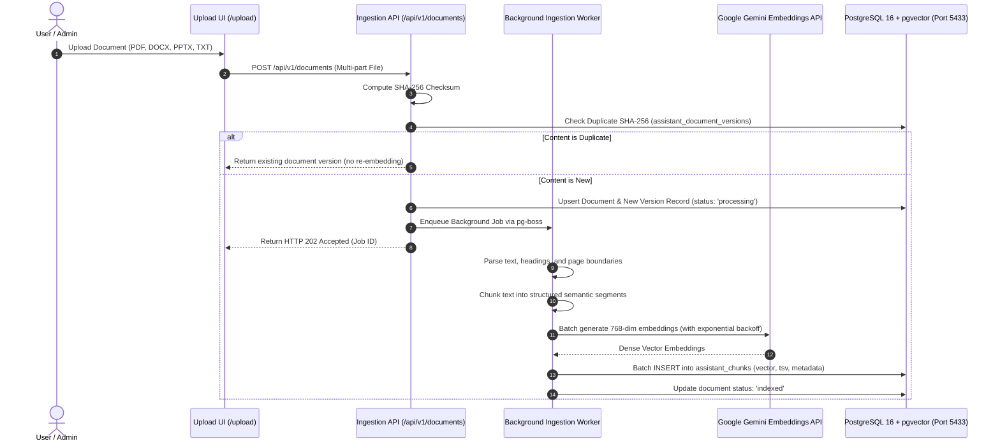
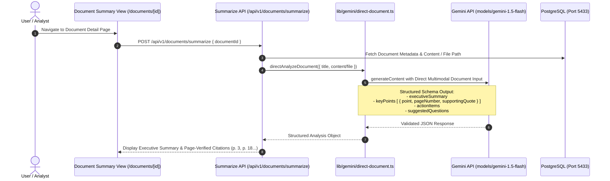
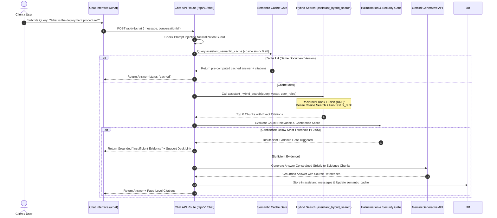
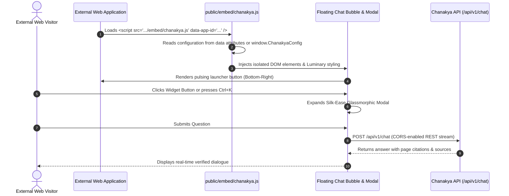

# Chanakya AI Knowledge Assistant — System Execution Flows

This document details the complete end-to-end execution flows and architectural lifecycles of the Chanakya AI Knowledge Platform.

---

## 1. Document Ingestion & Vector Indexing Flow

---

## 2. Direct Gemini Long-Context Document Analysis Flow

Designed for whole-document comprehension (e.g., ~100-page enterprise manuals) using Gemini Flash's native context window.

---

## 3. Conversational RAG & Evidence-Grounded Retrieval Flow

---

## 4. Universal Embeddable Click-and-Chat SDK Flow

Allows any external website or internal portal to integrate Chanakya with one line of JavaScript.

---

## 5. Background Ingestion & Maintenance Pipeline

- **Worker Process**: `workers/assistant-ingestion/worker.ts` powered by `pg-boss`.
- **Scheduled Jobs**:
  - Re-indexing queue for out-of-date vector embeddings upon schema changes.
  - Periodic cache invalidation when new document versions are committed.
  - System health probes (`npm run health`) verifying database connectivity, vector index validity, and Gemini API quota.
